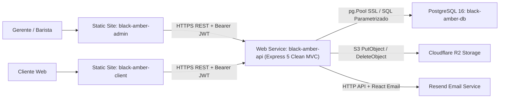
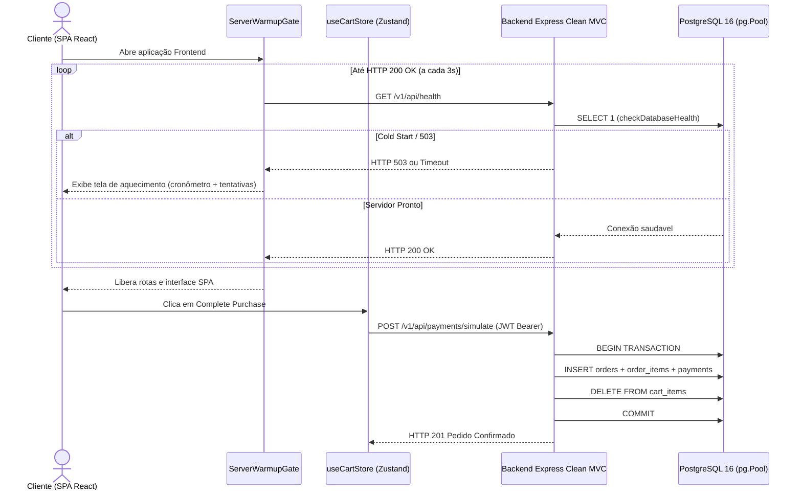
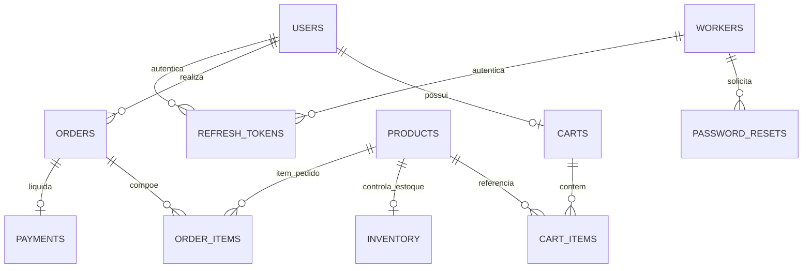

# 03. Diagramas Arquiteturais — Black Amber Coffee

## 1. Visão de Contêineres (Render Cloud)

---

## 2. Fluxo de Inicialização (`/health` Warmup Gate) e Checkout Atômico

---

## 3. Diagrama Entidade-Relacionamento (DER Resumido)

