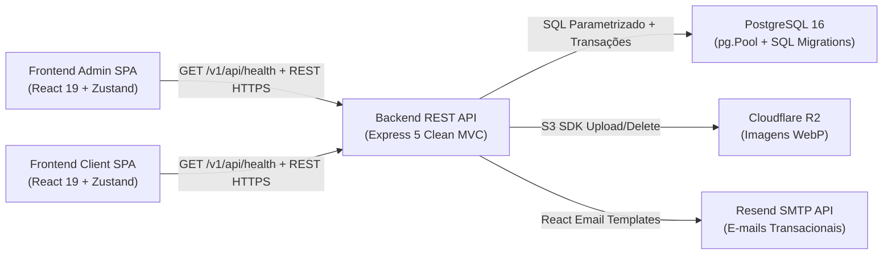

# Arquitetura e Organização do Ecossistema — Black Amber Coffee

> Documento de referência para engenharia, manutenção e evolução do projeto **Black Amber Coffee**.

---

## 1. Visão Geral em 3 Camadas

```text
Black-amber-coffee-Full-stack/
├── Database/                 # Schema Mestre PostgreSQL 16, migrações SQL, seed e Docker + Adminer
├── Backend/                  # API RESTful Clean MVC Feature-Driven (Express 5 + pg.Pool + TypeScript ESM)
├── Frontend/                 # Monorepo React 19 + Vite + Tailwind v4 + Zustand + ServerWarmupGate
│   ├── app/admin/            # Painel administrativo e cozinha em tempo real
│   ├── app/client/           # App Web de pedidos para clientes
│   └── packages/             # shared-utils (tipos/rotas/helpers) e ui-shared (componentes reutilizáveis)
├── docs/                     # Documentação técnica, diagramas, contratos e sprints
├── AGENTS.md                 # Governança de engenharia e padrão de cards
├── mkdocs.yml                # Configuração do portal de documentação estática
└── render.yaml               # Blueprint declarativo de deploy na Render (DB + API + 2 Static Sites)
```



---

## 2. Camada de Dados (`Database/`)

- **Engine:** PostgreSQL 16 puro com driver oficial `pg` (`Pool`) no Backend — sem Drizzle ORM e sem dependência de Supabase.
- **Arquivos:**
  - `Database/database.sql`: Fonte única da verdade (6 `ENUM`s, 13 tabelas, índices e trigger `atualizar_updated_at()`).
  - `Database/migrations/001_initial_schema.sql`: Migração DDL inicial idempotente.
  - `Database/seeds/01_seed_black_amber.sql`: Seed idempotente com usuários iniciais (`admin@blackamber.com`, `barista@blackamber.com`, `cliente@blackamber.com`), catálogo e estoque inicial.
- **Auto-Provisionamento na Nuvem:** Ao iniciar com `AUTO_MIGRATE=true` e `AUTO_SEED=true`, `Backend/core/database/migrator.ts` e `seeder.ts` aplicam o schema (com fallback embutido caso a árvore `Database/` esteja fora do contexto de container) e garantem o seed inicial sem duplicação.

---

## 3. Back-end (`Backend/`) — Clean MVC Feature-Driven

O Backend adota separação estrita por domínio em `Backend/api/` e infraestrutura transversal em `Backend/core/`:

```text
Request -> Routes (Middlewares Auth/RBAC/Zod/RateLimit) -> Controller (HTTP) -> Service (Regras/Transações) -> Model (SQL pg.Pool)
```

- **Features em `Backend/api/`:** `health`, `auth`, `worker`, `user`, `product`, `inventory`, `order`, `cart`, `payment`, `analytics`.
- **Infraestrutura em `Backend/core/`:** `config/env.ts`, `database/{postgres.client,migrator,seeder}.ts`, `errors/index.ts`, `jwt/jwt.service.ts`, `security/security.utils.ts`, `storage/{bucket.provider,image.service}.ts`, `mail/{mail.service,mail.provider,templates/*}`, `middlewares/*`, `swagger/swagger.ts`.
- **Padrões Obrigatórios:**
  - Queries parametrizadas contra SQL Injection (`$1`, `$2`).
  - `AuthMiddleware` consulta `is_active` em banco a cada requisição autenticada (`403 ACCOUNT_DEACTIVATED`).
  - `PaymentService` executa checkout atômico com `withTransaction` (`BEGIN`, cálculo de preços no servidor, criação do pedido, inserção de `order_items`, registro de `payments` e limpeza de `cart_items`).
  - `OrderModel` agrega itens via `json_agg` em consulta única (sem consultas N+1).
  - Respostas seguem o Envelope Pattern (`{ data, message }`).

---

## 4. Front-end (`Frontend/`) — Monorepo + Zustand + Warmup Gate

Mantendo a estrutura original de pastas do cliente (`app/admin`, `app/client`, `packages/ui-shared`, `packages/utils`), todo o gerenciamento de estado global baseado em `React Context` foi substituído por **Zustand** (`src/stores/`):

- **Admin Stores (`Frontend/app/admin/src/stores/`):** `useAuthStore`, `useOrderStore`, `useMenuStore`, `useEmployeeStore`, `useCustomerStore`, `useInventoryStore`.
- **Client Stores (`Frontend/app/client/src/stores/`):** `useAuthStore`, `useCartStore`, `useMenuStore`.
- **Compatibilidade por Hooks (`src/hooks/`):** Os hooks existentes delegam às stores Zustand sem necessidade de `<Provider>` no `App.tsx`, evitando cascatas de re-renderização e vazamentos de timers entre sessões.
- **Health Warmup Gate (`ServerWarmupGate`):** Ambos os frontends (`app/admin/src/App.tsx` e `app/client/src/App.tsx`) bloqueiam a renderização da aplicação até receber HTTP `200` de `GET /v1/api/health`, exibindo feedback visual de cold start na Render, cronômetro, contagem de tentativas e retry automático/manual.
- **Feedback Granular de Loading:** Estados por item/operação (`pendingOrderIds`, `pendingProductIds`, `pendingEmployeeIds`, `pendingCustomerIds`, `isSubmitting`, `isLoading`) controlam `LoadingSpinner` e `disabled` nos botões para evitar cliques duplicados.
